

  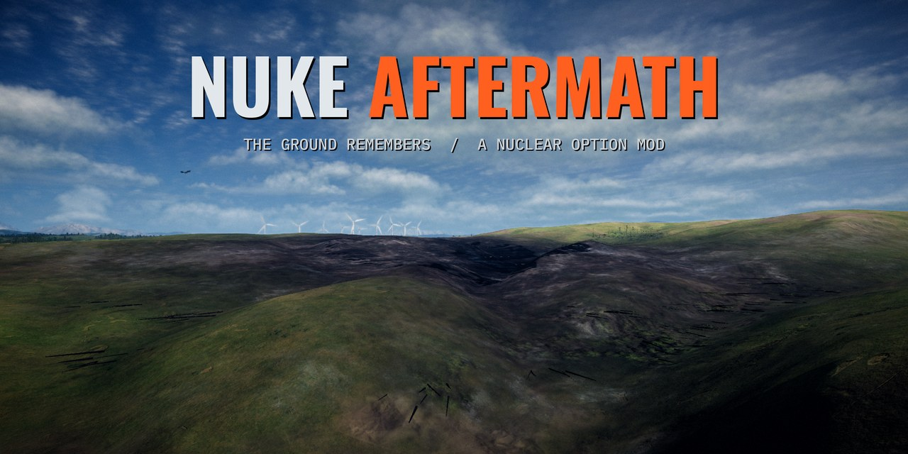

  <picture>
    <source media="(prefers-color-scheme: dark)" srcset="docs/media/logo-dark.png">
    
  </picture>

  <b>After a nuclear strike in Nuclear Option, the ground stays burnt and the forest lies flat.</b>

  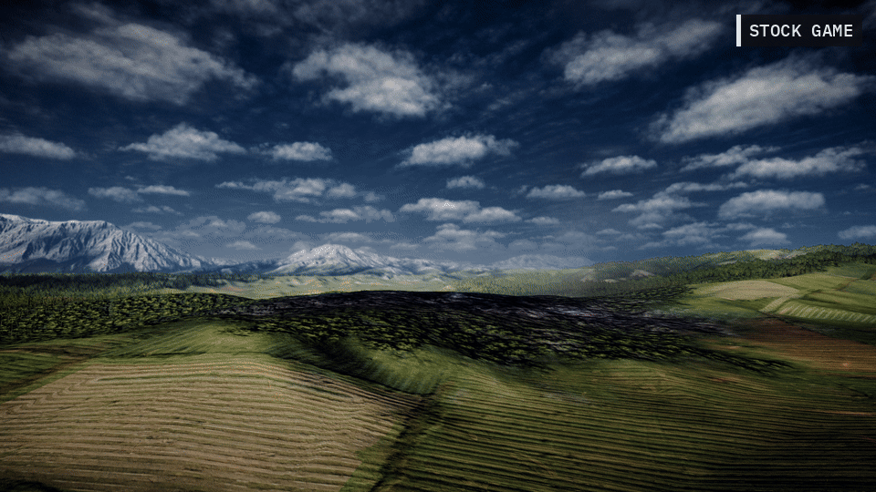

Nuke Aftermath is a free mod for [Nuclear Option](https://store.steampowered.com/app/2168680/). It is
fan-made and not affiliated with Shockfront Studios.

**Status: test build 0.1.0.** Made for Nuclear Option 0.34.1. Tested once, on Linux, on a recorded
real match played back in the game (see [Before and after](#before-and-after)). Not tested yet on
Windows, in a live mission or in multiplayer. Please report what you see.

## What it does

- **A scorch that fits the blast.** The stock game leaves a small dark mark at ground zero. Nuke
  Aftermath burns most of the area the blast cleared of trees, about 1.3 km across for a 1.5 kt bomb.
- **Fallen trees.** Where the blast wiped out the forest, you now see charred trunks lying on the
  ground, with a few bare trunks still standing near the edge.
- **It stays.** The scorch and the trunks are made to stay until you leave the map. The test checked
  them after three minutes.
- **Nothing to set up.** There are no keys. It reacts to every nuclear warhead by itself.
- **Only for you.** It changes what your game draws, nothing else. Other players do not need it, and
  it cannot change the outcome of a match.

## Before and after

The same strike, filmed twice from the same cameras: once in the stock game and once with Nuke
Aftermath. It is a 1.5 kt nuclear bomb from a real recorded match, about 150 m above a forested valley.
Both sides have the same colour grade. Only the labels are added.

### Three minutes after the strike

| Stock game | Nuke Aftermath |
|---|---|
| 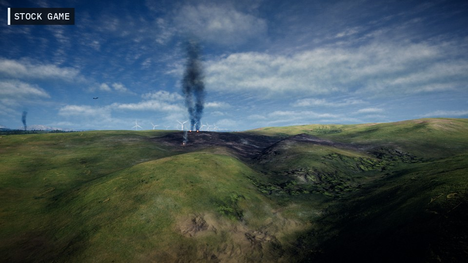 | 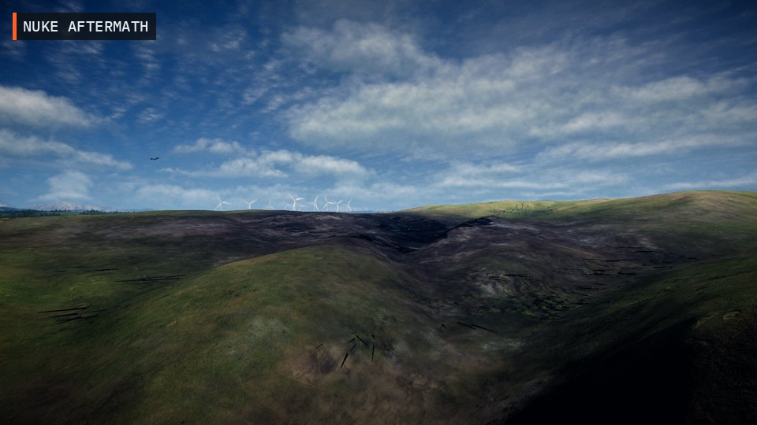 |
| A small dark patch where the bomb went off. | The whole valley is burnt, with fallen trunks in front. |
| 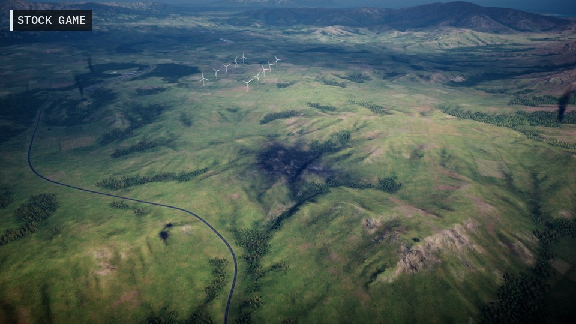 | 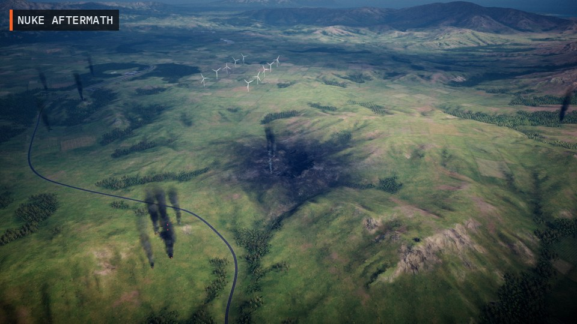 |
| From about 1.9 km away. | The burn is easy to see from the air. |
| 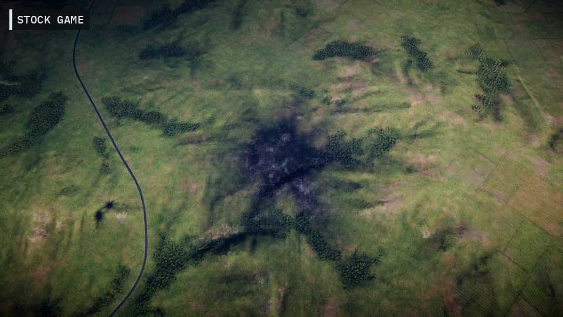 | 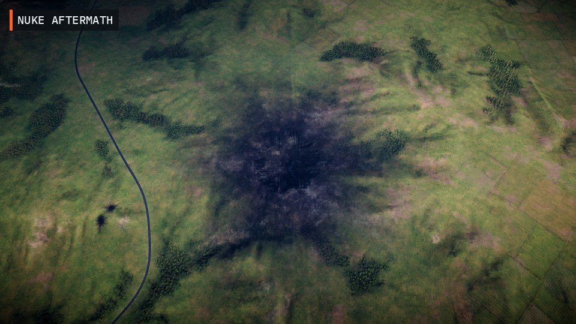 |
| From above: the stock scorch. | A bigger, darker burn. The trees outside the blast stay green. |

  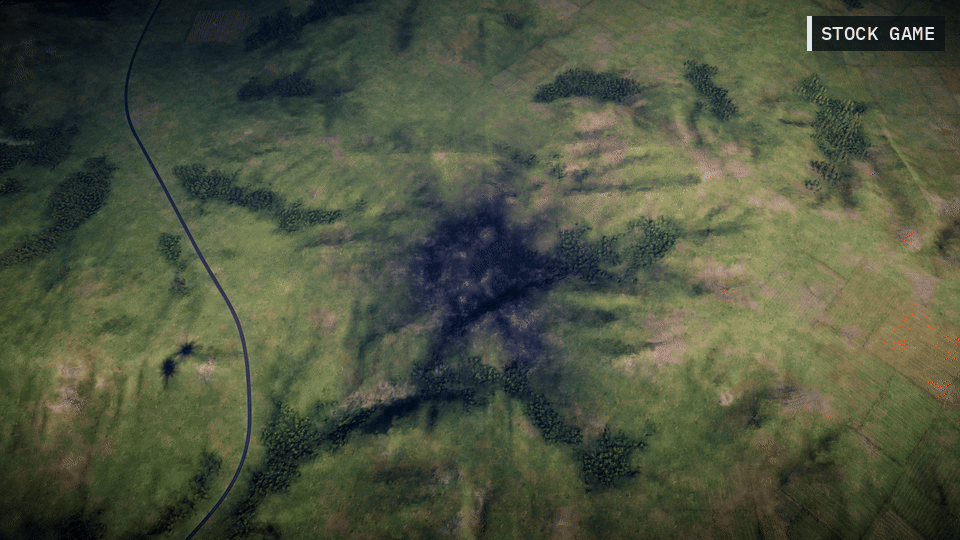

### Thirty seconds after the strike

| Stock game | Nuke Aftermath |
|---|---|
| 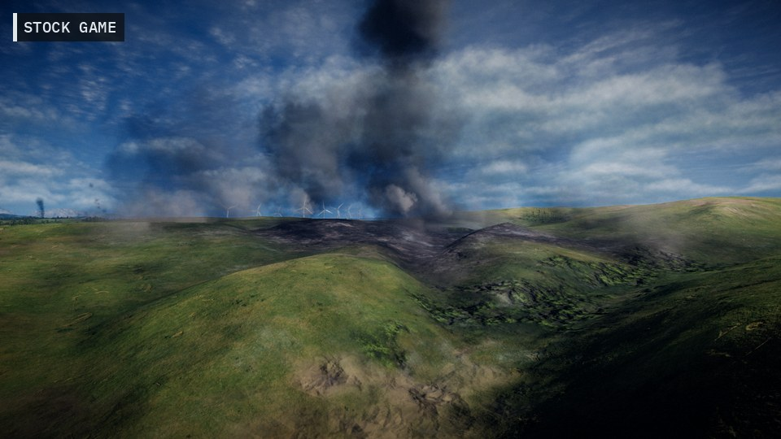 | 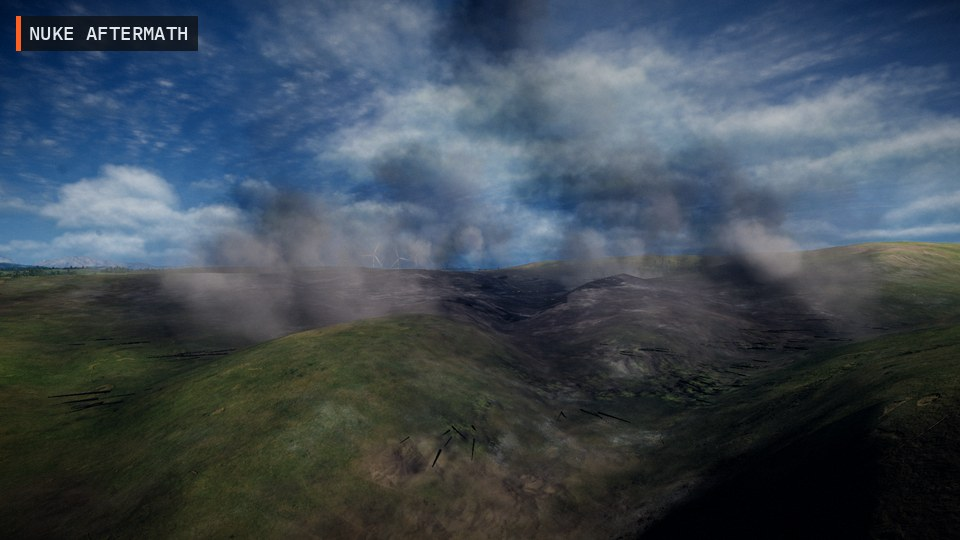 |

### The blast itself

The explosion is the stock one. Nuke Aftermath only changes what is left behind.

| Stock game | Nuke Aftermath |
|---|---|
| 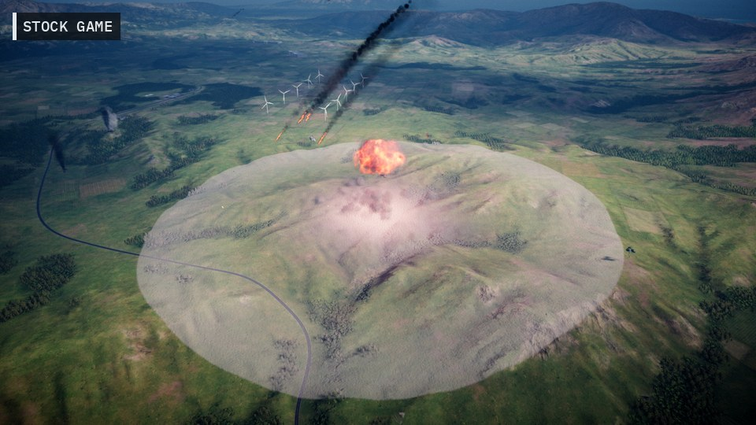 | 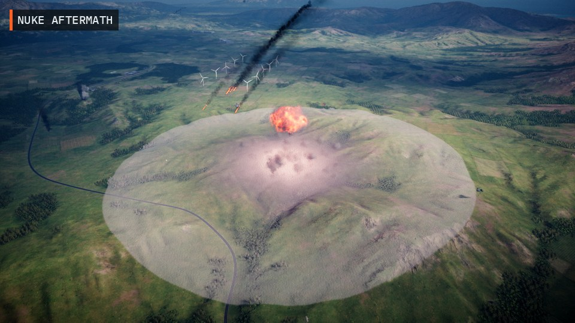 |

### Up close

| | |
|---|---|
| 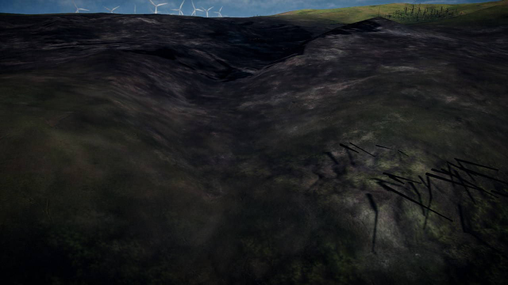 | 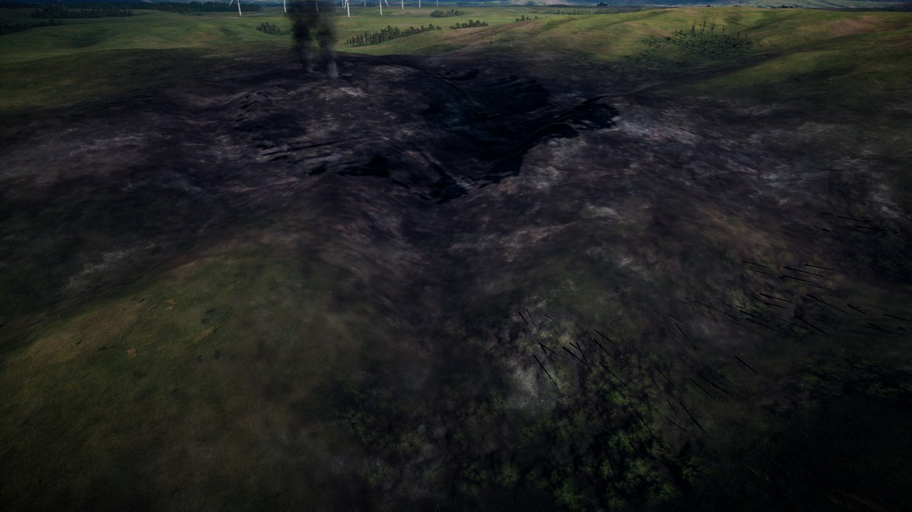 |
| Fallen trunks, about 200 m from ground zero. | Ground zero, three minutes later. |

## Install

You need Nuclear Option from Steam.

1. Install [BepInEx 5](https://github.com/BepInEx/BepInEx/releases) (the x64 version for Windows)
   into your Nuclear Option folder, if it is not there yet. BepInEx is the mod loader most Nuclear
   Option mods use. On Linux, also set this Steam launch option for the game:
   `WINEDLLOVERRIDES="winhttp=n,b" %command%`
2. Download `NoNukeAftermath-<version>.zip` from
   [Releases](https://github.com/Talamander/no-nuke-aftermath/releases).
3. Unzip it into your Nuclear Option folder (the folder with `NuclearOption.exe`). You should now have
   `BepInEx/plugins/NoNukeAftermath/NoNukeAftermath.dll`.
4. Start the game and play a mission with a nuclear weapon.

To check that it loaded, open `BepInEx/LogOutput.log` in your Nuclear Option folder. It should have the
line `Nuke Aftermath 0.1.0 loaded.`

If you already use other BepInEx mods, they keep working. Nuke Aftermath only adds its own folder.

To find your Nuclear Option folder: in Steam, right-click Nuclear Option, then **Manage**, then
**Browse local files**.

## Uninstall

Close the game first.

- The mod: delete `BepInEx/plugins/NoNukeAftermath` in your game folder.
- Its settings: delete `BepInEx/config/talamander.no.nukeaftermath.cfg`.
- The mod loader: if no other mod uses BepInEx, also delete `BepInEx`, `winhttp.dll`,
  `doorstop_config.ini`, `.doorstop_version` and `changelog.txt` from the game folder.

## Questions and limits

**Do other players need it?**
No. Each player who wants to see the aftermath installs it. Players without it see the stock game.
The host and dedicated servers need nothing.

**Does it work in multiplayer?**
It should, because it only changes what your own game draws, and it reacts to the same explosion
every player sees. It has not been tested in multiplayer yet.

**Can it get me out of sync or change the match?**
No. Trees in Nuclear Option have no effect on the game, and the mod does not touch buildings, units or
damage. It only adds things to look at.

**What about performance?**
The trunks are built once, a few frames after the blast, and drawn as a handful of simple meshes. In
the test (58 tree clumps cleared) there was no visible stutter, but frame time was not measured. Very
large blasts over dense forest make more trunks; there is a cap.

**I joined a match after a nuke went off. Why is there no scorch?**
The mod only knows about explosions it saw. The stock game is the same: a player who joins late also
sees a full forest.

**Can I change it?**
Yes, in `BepInEx/config/talamander.no.nukeaftermath.cfg` (it appears after the first start). You can
turn the scorch or the trunks off, change the scorch size, and change how many trunks each lost tree
leaves.

**Something does not work.**
Open an issue on [GitHub](https://github.com/Talamander/no-nuke-aftermath/issues). Say what you did and
what went wrong, and attach `BepInEx/LogOutput.log` from your Nuclear Option folder. Attach it right
after the problem, before you start the game again, because the game rewrites it on every start.

## More mods

- [Nuclear Replay](https://github.com/Talamander/nuclear-replay): record your matches and watch them
  back from any angle. The comparison above was filmed with it.
- [Missile Cam](https://github.com/Talamander/no-missile-cam): follow your own missiles in flight with the
  camera, and look at your selected target.

## Credits and license

Made by Talamander. Nuke Aftermath is a fan-made mod. It is not made, supported or endorsed by
Shockfront Studios, the makers of Nuclear Option.

Nuke Aftermath is released under the [MIT license](LICENSE). It uses the game's own scorch material and
needs BepInEx, which keeps its own license.

## For developers

How it works, the test log and how to build it are in [docs/DEVELOPMENT.md](docs/DEVELOPMENT.md).
